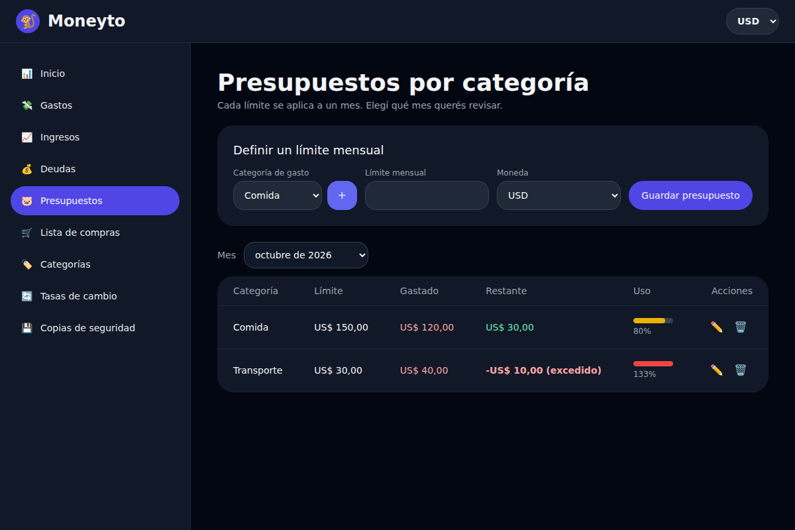
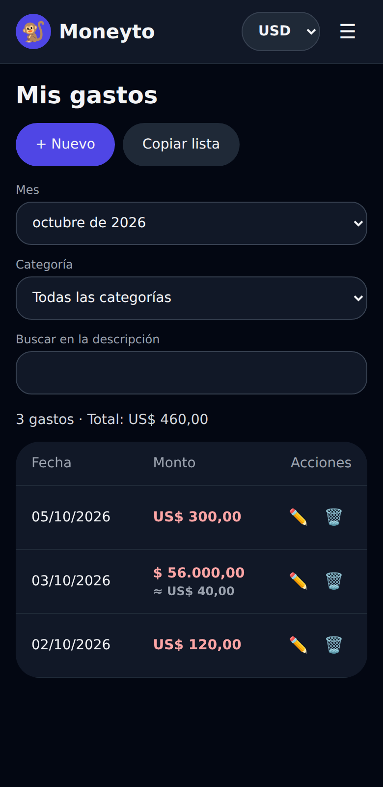

# Moneyto 🐒

App de finanzas personales para llevar ingresos, gastos, deudas y presupuestos desde el celular. Está hecha con HTML, JavaScript y Tailwind CSS, y se empaqueta como app de Android con [Capacitor](https://capacitorjs.com/). Los datos se guardan en el dispositivo, sin servidor ni cuenta.

> **English summary:** Moneyto is a personal finance app (income, expenses, debts, monthly budgets, multi-currency totals, local backups). Built with vanilla JavaScript and Tailwind CSS, wrapped as an Android app with Capacitor. Data stays on the device. The core logic is dependency-free and unit tested with Node's built-in test runner.

<p>
  
  
</p>

## Qué hace

- **Gastos e ingresos** con fecha, monto, moneda, categoría y descripción. Filtros por mes, categoría y texto.
- **Multi-moneda real (USD, EUR, ARS).** Cada movimiento conserva su moneda original; los totales se convierten a la moneda elegida arriba usando tus tasas de cambio. Si falta una tasa, la app lo avisa en vez de mostrar un total incorrecto.
- **Presupuestos mensuales por categoría**, con barra de uso y aviso cuando te pasás del límite. Se pueden revisar meses anteriores.
- **Deudas** con estado calculado por fecha (pendiente, vence pronto, vence hoy, vencida, pagada) y **recordatorios** el día anterior y el día del vencimiento.
- **Lista de compras** que al finalizar se guarda como un gasto con el total y el detalle.
- **Inicio** con balance, gráficos por categoría y las deudas que necesitan atención.
- **Copias de seguridad** en archivo JSON (guardar, compartir o copiar como texto) y restauración con validación. Lee también las copias de la versión anterior.

## Tecnologías

| Parte | Tecnología |
| --- | --- |
| Interfaz | HTML, JavaScript (sin framework), Tailwind CSS 3 |
| Gráficos | Chart.js 4 |
| App móvil | Capacitor (Android) con los plugins Local Notifications, Filesystem y Share |
| Almacenamiento | `localStorage` |
| Tests | `node:test` (incluido en Node, sin dependencias) |

## Cómo correrla en el navegador

No hace falta instalar nada para verla funcionando. Desde la carpeta del proyecto:

```bash
python3 -m http.server 8080 --directory www
```

y abrí `http://localhost:8080` (en Windows, `python` en lugar de `python3`). También sirve cualquier otro servidor estático.

## Compilar para Android

Requisitos: Node.js 20 o más nuevo y Android Studio.

```bash
npm install
npm install @capacitor/core @capacitor/android @capacitor/local-notifications @capacitor/filesystem @capacitor/share
npm install -D @capacitor/cli

npx cap add android      # solo la primera vez
npx cap sync android
npx cap open android     # compilá el APK desde Android Studio
```

Si ya tenés un proyecto Capacitor con `android/`, alcanza con instalar los tres plugins, copiar el contenido de `www/` y correr `npx cap sync android`.

## Tests

```bash
npm test
```

Cubre la lógica pura de `www/js/core.js`: conversión de monedas (directa, inversa y vía USD), fechas locales, estado de presupuestos y deudas, escape de HTML y validación de copias de seguridad (formatos v1 y v2).

## Estructura

```
www/
├── *.html              una página por pantalla
├── css/
│   ├── tailwind.css    compilado y versionado (la app no necesita internet para los estilos)
│   └── styles.css      tipografía, áreas seguras de Android, foco visible
└── js/
    ├── core.js         lógica pura, testeable (monedas, fechas, presupuestos, backups)
    ├── storage.js      acceso a localStorage y migración de datos viejos
    ├── ui.js           avisos, formato de dinero, modales
    ├── notifications.js  recordatorios de deudas
    ├── layout.js       barra superior y menú compartidos
    └── pages/          un archivo por pantalla
tests/core.test.js
src/input.css           entrada de Tailwind
```

Para cambiar estilos o clases de Tailwind: `npm install` y `npm run build:css`.

## Datos y privacidad

Todo se guarda en el `localStorage` del dispositivo; Moneyto no envía datos a ningún servidor. Eso significa que **si desinstalás la app o borrás sus datos, se pierden**: usá la pantalla de copias de seguridad de vez en cuando. Los datos no están cifrados.

Se mantienen las claves `gp_*` de la versión anterior, así que quien ya tenía datos cargados los conserva.

## Limitaciones conocidas

- Las tasas de cambio se cargan a mano. No hay actualización automática.
- Chart.js se carga desde un CDN. Sin conexión, el inicio muestra la lista de categorías en texto en lugar del gráfico.
- No hay sincronización entre dispositivos.
- Los recordatorios nativos y el guardado de copias con el menú de compartir de Android usan la API de los plugins de Capacitor, pero todavía no se probaron en un dispositivo físico. Según la versión de Android, un aviso puede demorar unos minutos si el sistema no permite alarmas exactas.

## Licencia

[MIT](LICENSE)
